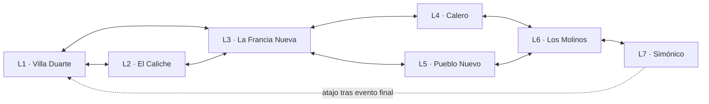

# LATINO AMÉRICA Zector Cero — Plan maestro de siete niveles y 382 salas

**Versión:** 1.0 · **Fecha:** 2 de noviembre de 2026  
**Estado:** estructura maestra de diseño y registro de salas creada; la geometría interna, puertas y eventos de cada sala se deben mapear antes de cualquier parche binario.

## Canon de siete barrios

Esta versión adopta la distribución exacta del atlas visual acordado: Villa Duarte, El Caliche, La Francia Nueva, Calero, Pueblo Nuevo, Los Molinos y Simónico. Los siete nombres son sectores creativos del juego. No se presentan como una delimitación administrativa oficial de Villa Duarte.

| Nivel | Barrio | Área fuente de referencia | Salas | Identidad jugable |
|---|---|---|---:|---|
| 1 | **Villa Duarte** | Main Deck | 87 | El corazón habitado: colmados, viviendas de hormigón, balcones, rejas, motocicletas, sillas, cableado aéreo y calles de escala media. La cuarentena/hangar se disimula como infraestructura logística urbana, no como un octavo distrito. |
| 2 | **El Caliche** | Sector 1 | 54 | Callejones estrechos, fachadas cercanas, muros gastados, puertas y ventanas con rejas, escalones, drenajes y pasajes que giran. La compresión espacial es el sello del nivel. |
| 3 | **La Francia Nueva** | Sector 2 | 61 | Zona residencial de escala más abierta: calles asfaltadas, aceras, viviendas de varias plantas, portones, coches aparcados, patios y árboles puntuales. Debe respirar frente a El Caliche. |
| 4 | **Calero** | Sector 3 | 39 | Trabajo y resistencia: talleres, construcciones, maquinaria, escombros, persianas metálicas y generadores. No convertirlo en fábrica genérica; conservar escala de taller y calle. |
| 5 | **Pueblo Nuevo** | Sector 4 | 48 | Tradición y comunidad: casas en ladera, escaleras, terrazas, miradores y cambios de altura; la topografía organiza el nivel. |
| 6 | **Los Molinos** | Sector 5 | 52 | Río, puentes, fábricas, zonas industriales y estructuras abandonadas. El nivel mezcla agua, industria y servicio, con lectura de rutas por pasarelas y canales. |
| 7 | **Simónico** | Sector 6 | 41 | Cierre nocturno con arte urbano, cultura, música y resistencia. Calles vivas y duras; murales originales y espacios comunitarios, no grafitis reales copiados. |

**Cobertura total:** 7 niveles · 382 entradas de sala registradas. La distribución conserva los conteos de las siete áreas de la referencia técnica: Main Deck 87, Sector 1 54, Sector 2 61, Sector 3 39, Sector 4 48, Sector 5 52 y Sector 6 41.

## Reglas de organización

1. La numeración original de sala se conserva. `room_index_1based` es el índice legible del CSV; `room_index_0based` es el índice de array para la referencia C.
2. `tileset_entry_index` se conserva separado de los IDs de gráficos, paleta, fondo y tilemap. No son equivalentes.
3. El rol de sala es una asignación creativa inicial basada en el mapa estratégico: orden de `map_y`, después `map_x` y finalmente índice original. Las coordenadas no demuestran conexiones físicas ni puertas.
4. No se inventan adyacencias internas. Las conexiones entre barrios incluidas aquí son rutas de diseño; las puertas originales deben extraerse de las tablas de `Door` y cruzarse con los destinos reales.
5. El clipdata/colisiones originales se conservan como referencia hasta que exista un rediseño específico por sala. No convertir un fondo en plataforma sin modificar y auditar la colisión.
6. Los recursos compartidos no se reemplazan globalmente. Antes de modificar un tileset o una paleta, listar todos sus consumidores.

## Plano macro de conexiones propuesto

El acceso temprano L1→L3 evita un softlock si L2 contiene una puerta que dependa de una mejora todavía no obtenida. Los requisitos de habilidades no se codifican hasta cruzar el orden real de adquisición, los eventos y las tablas de puertas.

## Dirección por nivel y presupuesto de salas

### Nivel 1 — Villa Duarte (87 salas)

**Identidad:** El corazón habitado: colmados, viviendas de hormigón, balcones, rejas, motocicletas, sillas, cableado aéreo y calles de escala media. La cuarentena/hangar se disimula como infraestructura logística urbana, no como un octavo distrito.
**Paleta:** ámbar, coral gastado, crema de hormigón, azul petróleo y verde vegetal.
**Luz:** Atardecer cálido; sombras largas bajo balcones y vehículos; zonas de juego despejadas.
**Peligros y mecánicas ambientales:** cables caídos señalizados, portones automatizados, cajas eléctricas y patrullas de vigilancia.
**Papel narrativo:** Aterrizaje, llegada al tejido urbano, primer contacto con el barrio, tutorial de lectura del entorno y primera señal de una instalación oculta.

| Grupo de salas | Cantidad | Uso y composición |
|---|---:|---|
| Hangar de cuarentena | 4 | Llegada, contenedores, verja de carga y esclusa de descontaminación; tutorial de interacción y primer giro narrativo. |
| Calle principal | 12 | Tramo lateral continuo con colmado ficticio, motor aparcado, acera y fachadas de dos o tres alturas; lectura clara de suelo y puertas. |
| Fachadas habitadas | 14 | Variaciones de galerías, balcones, ventanas enrejadas, ampliaciones y medianeras; evitar repetir edificios idénticos. |
| Colmado y viviendas | 10 | Interiores breves, estantes, almacén, patios interiores y habitaciones; zonas de conversación y búsqueda. |
| Balcones y azoteas | 12 | Pretiles, escaleras, antenas y pasarelas sobre calle; primeras rutas verticales, sin exigir habilidad no adquirida. |
| Red de telecomunicaciones | 9 | Postes, transformadores, cajas y cableado; introduce cortes eléctricos con señal visual previa. |
| Pasos de servicio | 8 | Patios traseros, cuarto de bombas y corredores técnicos que conectan la calle con la instalación. |
| Puntos de control y briefing | 8 | Salas de información, refugio y navegación; reubicar sus funciones narrativas al lenguaje urbano. |
| Encuentros de historia | 4 | Espacios de emboscada, rescate y revelación; cada uno deja salida y ruta de retorno. |
| Atajos vecinales | 4 | Huecos, patios conectados, escalera lateral y acceso de vuelta; recompensan exploración. |
| Set-piece de combate | 2 | Dos espacios de enfrentamiento/amenaza mayor, sin fijar nombre de jefe hasta cruzar el canon narrativo. |

**Registro individual:** ver `sector-cero-room-registry-v1.json`, que asigna nombre, ID, barrio, función, coordenadas y referencias técnicas a cada sala.

### Nivel 2 — El Caliche (54 salas)

**Identidad:** Callejones estrechos, fachadas cercanas, muros gastados, puertas y ventanas con rejas, escalones, drenajes y pasajes que giran. La compresión espacial es el sello del nivel.
**Paleta:** rojo ladrillo apagado, salmón erosionado, gris cemento, verde pálido y azul sombra.
**Luz:** Luz cálida cortada en franjas desde la entrada; fondos fríos y oscuros, sin ocultar al protagonista.
**Peligros y mecánicas ambientales:** drenajes abiertos señalizados, portones, derrumbes parciales, emboscadas y zonas de persecución.
**Papel narrativo:** El barrio se vuelve laberinto; aparecen rutas cortas, persecución y señales de que la amenaza se mueve por los pasadizos.

| Grupo de salas | Cantidad | Uso y composición |
|---|---:|---|
| Red de callejones | 11 | Pasajes estrechos con quiebros, fachadas pegadas, cableado alto y salidas laterales; navegación por referencias visuales. |
| Viviendas encajadas | 9 | Interiores superpuestos, escaleras cortas, patios de luz y habitaciones conectadas; explorar sin confundir decorado con plataforma. |
| Drenajes y alcantarillas | 7 | Canales, registros, colectores y pasos bajos; introduce navegación a ras del suelo y lectura de agua contaminada. |
| Rejas y rutas de seguridad | 8 | Portones, candados, cámaras y accesos de patio; puertas legibles con estado abierto/cerrado. |
| Cuartos de servicio | 6 | Contadores, bajantes, cableado y depósitos; pistas sobre la infraestructura oculta. |
| Persecución y emboscada | 5 | Pasillos de escape y salas de giro; cada persecución necesita espacio de reacción y ruta alternativa. |
| Refugios | 3 | Puntos de calma, guardado/briefing y NPC de apoyo; cambian el ritmo del nivel. |
| Pasajes secretos | 3 | Huecos detrás de rejas, muros falsos y conexiones de azotea; atajos de regreso. |
| Encuentros de élite | 2 | Dos arenas confinadas con espacio de esquiva, cobertura y salida persistente. |

**Registro individual:** ver `sector-cero-room-registry-v1.json`, que asigna nombre, ID, barrio, función, coordenadas y referencias técnicas a cada sala.

### Nivel 3 — La Francia Nueva (61 salas)

**Identidad:** Zona residencial de escala más abierta: calles asfaltadas, aceras, viviendas de varias plantas, portones, coches aparcados, patios y árboles puntuales. Debe respirar frente a El Caliche.
**Paleta:** menta, turquesa, azul cielo, crema, amarillo solar y asfalto gris azulado.
**Luz:** Luz diurna, sombras de árboles y aleros, horizonte más abierto y fachadas con variedad de altura.
**Peligros y mecánicas ambientales:** cruces de tráfico, plataformas elevadas, accesos con visibilidad parcial y trampas tecnológicas puntuales.
**Papel narrativo:** Pausa de orientación y reconstrucción del mapa mental; el jugador descubre que el fenómeno afecta a varias calles, no solo a los callejones.

| Grupo de salas | Cantidad | Uso y composición |
|---|---:|---|
| Calles residenciales | 14 | Tramos anchos, aceras legibles, cruces de calles y fachadas de varias alturas; la ruta principal queda visible. |
| Cruces y carriles | 10 | Intersecciones con coches y motocicletas estacionadas, zonas de paso y peligros móviles claramente telegráficos. |
| Viviendas de varias plantas | 8 | Escaleras, galerías, patios y descansillos; alternar exterior/interior sin perder orientación. |
| Patios y garajes | 7 | Garajes, talleres domésticos pequeños, patios y entradas; espacio para secretos y NPC. |
| Parques y plazoletas | 6 | Árboles puntuales, bancos, canchas pequeñas y plazas vecinales; descanso y encuentros sociales. |
| Servicios de calle | 5 | Paradas, pequeños comercios, depósitos y puntos de información; ambientación no interactiva y pickups. |
| Rutas elevadas | 4 | Pasarelas, muros y techos bajos; ruta de habilidad secundaria con alternativa inicial. |
| Rescate y briefing | 3 | Salas de misión, refugio y rescates; integrar objetivos persistentes. |
| Encuentros de historia | 3 | Escenarios para diálogos, emboscadas y enemigo de élite. |
| Habitación secreta | 1 | Una sala de recompensa escondida detrás de una conexión secundaria. |

**Registro individual:** ver `sector-cero-room-registry-v1.json`, que asigna nombre, ID, barrio, función, coordenadas y referencias técnicas a cada sala.

### Nivel 4 — Calero (39 salas)

**Identidad:** Trabajo y resistencia: talleres, construcciones, maquinaria, escombros, persianas metálicas y generadores. No convertirlo en fábrica genérica; conservar escala de taller y calle.
**Paleta:** azul acero, óxido, ocre, cemento oscuro y señales de seguridad.
**Luz:** Exterior neutro y reflejos puntuales de metal; interior cálido, polvo y focos de trabajo.
**Peligros y mecánicas ambientales:** calor, maquinaria cíclica, vapor, zonas eléctricas y plataformas mecánicas con patrones previsibles.
**Papel narrativo:** El jugador entra en una zona donde la infraestructura se manipula activamente y encuentra pruebas de mantenimiento clandestino.

| Grupo de salas | Cantidad | Uso y composición |
|---|---:|---|
| Talleres | 8 | Bahías de reparación, elevadores, ruedas, estanterías y persianas; plataformas y coberturas robustas. |
| Obras y estructuras | 7 | Andamios, bloques, columnas, huecos y montacargas; rutas verticales señalizadas. |
| Plataformas mecánicas | 6 | Cintas, prensas y brazos móviles; ciclos legibles antes de exigir saltos. |
| Generadores y energía | 5 | Cuartos de generadores, cuadros eléctricos y transformadores; conexiones a sectores vecinos. |
| Corredores térmicos | 4 | Tuberías, válvulas y calor ambiental; usar la temperatura como peligro, no como decoración aleatoria. |
| Interiores de taller | 3 | Oficina, almacén de repuestos y cuarto de herramientas; refugio y pistas. |
| Encuentros de élite | 3 | Arenas entre máquinas con coberturas y plataformas de seguridad. |
| Control y seguridad | 2 | Paneles de acceso, cámaras y control de energía; lógica de interruptores. |
| Hueco técnico secreto | 1 | Un alijo detrás de maquinaria aislada y claramente señalizada. |

**Registro individual:** ver `sector-cero-room-registry-v1.json`, que asigna nombre, ID, barrio, función, coordenadas y referencias técnicas a cada sala.

### Nivel 5 — Pueblo Nuevo (48 salas)

**Identidad:** Tradición y comunidad: casas en ladera, escaleras, terrazas, miradores y cambios de altura; la topografía organiza el nivel.
**Paleta:** violeta, índigo, melocotón de atardecer, hormigón cálido y acentos turquesa.
**Luz:** Hora azul y atardecer; luces domésticas en ventanas y sombras violeta controladas.
**Peligros y mecánicas ambientales:** caídas con retorno seguro, escaleras, depósitos elevados, plataformas móviles y rutas verticales.
**Papel narrativo:** El jugador domina el movimiento vertical, descubre miradores y accede a rutas alternativas sobre el tejido de viviendas.

| Grupo de salas | Cantidad | Uso y composición |
|---|---:|---|
| Calles en ladera | 10 | Tramos escalonados de vivienda y calle; el desnivel debe leerse con continuidad de suelo. |
| Escaleras y recodos | 8 | Escalinatas, descansos, rampas y curvas; crear lectura clara de arriba/abajo. |
| Azoteas y terrazas | 8 | Pretiles, pasarelas y patios altos; rutas de habilidad y atajos. |
| Miradores | 5 | Vistas de la ciudad y calles inferiores; función de orientación y transición. |
| Patios y viviendas | 4 | Patios interiores, galerías y salas; recompensas de exploración. |
| Tanques y depósitos | 4 | Cisternas, depósitos elevados y tuberías; gestión ambiental. |
| Cisternas y pasos de servicio | 3 | Pasos estrechos, registros y túneles asociados a depósitos. |
| Retos de movimiento | 2 | Dos salas que combinan ascenso, salto y plataformas sin bloquear el retorno. |
| Rescate y checkpoint | 2 | Puntos seguros con rescate, guardado y orientación. |
| Arena de combate | 1 | Arena con desniveles, zonas seguras y entradas múltiples. |
| Sala secreta | 1 | Recompensa escondida fuera de la ruta principal. |

**Registro individual:** ver `sector-cero-room-registry-v1.json`, que asigna nombre, ID, barrio, función, coordenadas y referencias técnicas a cada sala.

### Nivel 6 — Los Molinos (52 salas)

**Identidad:** Río, puentes, fábricas, zonas industriales y estructuras abandonadas. El nivel mezcla agua, industria y servicio, con lectura de rutas por pasarelas y canales.
**Paleta:** cian oscuro, pizarra, verde industrial, óxido apagado y ámbar de señalización.
**Luz:** Azul grisáceo, reflejos húmedos selectivos y focos cálidos aislados.
**Peligros y mecánicas ambientales:** canales, bombas, compuertas, frío de almacenamiento, maquinaria y pasarelas.
**Papel narrativo:** Convergencia de la infraestructura hídrica y energética; se revela parte de la red que sostiene la instalación oculta.

| Grupo de salas | Cantidad | Uso y composición |
|---|---:|---|
| Accesos al río | 8 | Orillas, muros, rampas y muelles de servicio; introducir el frente fluvial. |
| Red de puentes | 7 | Pasarelas, pilares y cruces elevados; rutas de avance y atajos. |
| Plantas de fábrica | 8 | Naves, prensas, depósitos y maquinaria; salas de combate de escala amplia. |
| Bloques industriales abandonados | 7 | Estructuras vacías, oficinas degradadas y zonas de carga; exploración y emboscadas. |
| Canales y bombas | 6 | Canales, depósitos, bombas y compuertas; peligro de agua gestionable. |
| Cámaras frías y servicio | 5 | Cámaras de conservación, pasillos de escarcha y depósitos; adaptar el motivo frío existente sin copiar su apariencia. |
| Cintas y vías | 4 | Transportadores, rieles y plataformas móviles; enseñar patrón antes de combate. |
| Turbinas y generadores | 3 | Cuartos de turbina, líneas de energía y mantenimiento. |
| Control y navegación | 2 | Sala de control y estación técnica; pistas hacia el sector final. |
| Combates mayores | 2 | Dos espacios de combate con cobertura y rutas de salida. |

**Registro individual:** ver `sector-cero-room-registry-v1.json`, que asigna nombre, ID, barrio, función, coordenadas y referencias técnicas a cada sala.

### Nivel 7 — Simónico (41 salas)

**Identidad:** Cierre nocturno con arte urbano, cultura, música y resistencia. Calles vivas y duras; murales originales y espacios comunitarios, no grafitis reales copiados.
**Paleta:** azul marino, morado, magenta, cian y ámbar cálido.
**Luz:** Noche azul, luces cálidas de comercios, magenta y cian controlados como acentos de señalización.
**Peligros y mecánicas ambientales:** apagones, enemigos de patrulla, pasarelas de azotea, túneles y defensas de la instalación oculta.
**Papel narrativo:** La resistencia se organiza, aparece el núcleo oculto bajo la ciudad, ocurre el enfrentamiento final y se abre la ruta de escape/retorno.

| Grupo de salas | Cantidad | Uso y composición |
|---|---:|---|
| Calles nocturnas | 7 | Frentes comerciales, persianas, luces de ventanas y esquinas; guiar por puntos luminosos. |
| Corredores de arte urbano | 6 | Murales ficticios, paredes de expresión y pasos de calle; mantener el arte subordinado a la lectura de juego. |
| Patios culturales y música | 5 | Patios, canchas, equipos de sonido y pequeñas plazas; espacio de aliados y resistencia. |
| Refugios de resistencia | 5 | Viviendas seguras, almacenes y salas de reunión; puntos de misión y guardado. |
| Azoteas y callejones traseros | 4 | Rutas de altura y pasajes de vuelta; preparación del clímax. |
| Pasos subterráneos y catacumbas | 5 | Pasadizos bajo el tejido urbano; transición hacia el complejo oculto. |
| Laboratorio oculto y núcleo | 3 | Laboratorio biomédico, sala de control y núcleo; integra el motivo final sin añadir un octavo barrio. |
| Preparación del clímax | 1 | Sala previa al encuentro, ruta de salida y recurso de recuperación. |
| Arena final | 1 | Arena principal con espacio de lectura de fases y entradas/salidas persistentes. |
| Desenlace y escape | 2 | Dos salas de escape y cierre narrativo; una abre el retorno final al nivel inicial. |
| Secretos finales | 2 | Dos salas opcionales con recompensa y lore. |

**Registro individual:** ver `sector-cero-room-registry-v1.json`, que asigna nombre, ID, barrio, función, coordenadas y referencias técnicas a cada sala.

## Estado de todas las salas

El siguiente listado contiene las 382 salas asignadas. El número de sala y sus coordenadas apuntan a la referencia de origen; el título y el rol describen el destino creativo.

### L01 — Villa Duarte

| ID de diseño | Índice fuente | Sala diseñada | Rol | Mapa fuente (x,y) |
|---|---:|---|---|---|
| `L01_R082` | 82 | Hangar de cuarentena 01 | `hangar_quarantine` | (15, 0) |
| `L01_R013` | 13 | Hangar de cuarentena 02 | `hangar_quarantine` | (17, 0) |
| `L01_R074` | 74 | Hangar de cuarentena 03 | `hangar_quarantine` | (17, 0) |
| `L01_R085` | 85 | Hangar de cuarentena 04 | `hangar_quarantine` | (17, 0) |
| `L01_R039` | 39 | Calle principal 01 | `main_street` | (15, 1) |
| `L01_R032` | 32 | Calle principal 02 | `main_street` | (16, 1) |
| `L01_R035` | 35 | Calle principal 03 | `main_street` | (20, 1) |
| `L01_R022` | 22 | Calle principal 04 | `main_street` | (7, 2) |
| `L01_R069` | 69 | Calle principal 05 | `main_street` | (8, 2) |
| `L01_R015` | 15 | Calle principal 06 | `main_street` | (11, 2) |
| `L01_R044` | 44 | Calle principal 07 | `main_street` | (15, 2) |
| `L01_R081` | 81 | Calle principal 08 | `main_street` | (16, 2) |
| `L01_R060` | 60 | Calle principal 09 | `main_street` | (19, 2) |
| `L01_R076` | 76 | Calle principal 10 | `main_street` | (12, 4) |
| `L01_R011` | 11 | Calle principal 11 | `main_street` | (13, 4) |
| `L01_R061` | 61 | Calle principal 12 | `main_street` | (19, 4) |
| `L01_R012` | 12 | Fachadas habitadas 01 | `residential_facades` | (18, 5) |
| `L01_R075` | 75 | Fachadas habitadas 02 | `residential_facades` | (12, 6) |
| `L01_R021` | 21 | Fachadas habitadas 03 | `residential_facades` | (16, 6) |
| `L01_R009` | 9 | Fachadas habitadas 04 | `residential_facades` | (17, 6) |
| `L01_R036` | 36 | Fachadas habitadas 05 | `residential_facades` | (20, 6) |
| `L01_R010` | 10 | Fachadas habitadas 06 | `residential_facades` | (21, 6) |
| `L01_R038` | 38 | Fachadas habitadas 07 | `residential_facades` | (21, 6) |
| `L01_R037` | 37 | Fachadas habitadas 08 | `residential_facades` | (22, 6) |
| `L01_R084` | 84 | Fachadas habitadas 09 | `residential_facades` | (25, 6) |
| `L01_R018` | 18 | Fachadas habitadas 10 | `residential_facades` | (13, 7) |
| `L01_R057` | 57 | Fachadas habitadas 11 | `residential_facades` | (14, 7) |
| `L01_R008` | 8 | Fachadas habitadas 12 | `residential_facades` | (17, 7) |
| `L01_R045` | 45 | Fachadas habitadas 13 | `residential_facades` | (19, 7) |
| `L01_R073` | 73 | Fachadas habitadas 14 | `residential_facades` | (5, 8) |
| `L01_R019` | 19 | Colmado y viviendas 01 | `colmado_and_home_interiors` | (6, 8) |
| `L01_R040` | 40 | Colmado y viviendas 02 | `colmado_and_home_interiors` | (6, 8) |
| `L01_R041` | 41 | Colmado y viviendas 03 | `colmado_and_home_interiors` | (7, 8) |
| `L01_R042` | 42 | Colmado y viviendas 04 | `colmado_and_home_interiors` | (7, 8) |
| `L01_R023` | 23 | Colmado y viviendas 05 | `colmado_and_home_interiors` | (9, 8) |
| `L01_R020` | 20 | Colmado y viviendas 06 | `colmado_and_home_interiors` | (11, 8) |
| `L01_R070` | 70 | Colmado y viviendas 07 | `colmado_and_home_interiors` | (14, 8) |
| `L01_R033` | 33 | Colmado y viviendas 08 | `colmado_and_home_interiors` | (15, 8) |
| `L01_R014` | 14 | Colmado y viviendas 09 | `colmado_and_home_interiors` | (18, 8) |
| `L01_R071` | 71 | Colmado y viviendas 10 | `colmado_and_home_interiors` | (8, 9) |
| `L01_R072` | 72 | Balcones y azoteas 01 | `balconies_and_rooftops` | (12, 9) |
| `L01_R002` | 2 | Balcones y azoteas 02 | `balconies_and_rooftops` | (18, 9) |
| `L01_R034` | 34 | Balcones y azoteas 03 | `balconies_and_rooftops` | (6, 10) |
| `L01_R043` | 43 | Balcones y azoteas 04 | `balconies_and_rooftops` | (6, 10) |
| `L01_R031` | 31 | Balcones y azoteas 05 | `balconies_and_rooftops` | (7, 10) |
| `L01_R046` | 46 | Balcones y azoteas 06 | `balconies_and_rooftops` | (9, 10) |
| `L01_R016` | 16 | Balcones y azoteas 07 | `balconies_and_rooftops` | (12, 10) |
| `L01_R007` | 7 | Balcones y azoteas 08 | `balconies_and_rooftops` | (14, 10) |
| `L01_R006` | 6 | Balcones y azoteas 09 | `balconies_and_rooftops` | (16, 10) |
| `L01_R005` | 5 | Balcones y azoteas 10 | `balconies_and_rooftops` | (17, 10) |
| `L01_R001` | 1 | Balcones y azoteas 11 | `balconies_and_rooftops` | (20, 10) |
| `L01_R024` | 24 | Balcones y azoteas 12 | `balconies_and_rooftops` | (5, 11) |
| `L01_R047` | 47 | Red de telecomunicaciones 01 | `telecom_and_power` | (8, 11) |
| `L01_R030` | 30 | Red de telecomunicaciones 02 | `telecom_and_power` | (2, 12) |
| `L01_R029` | 29 | Red de telecomunicaciones 03 | `telecom_and_power` | (3, 12) |
| `L01_R028` | 28 | Red de telecomunicaciones 04 | `telecom_and_power` | (4, 12) |
| `L01_R025` | 25 | Red de telecomunicaciones 05 | `telecom_and_power` | (8, 12) |
| `L01_R026` | 26 | Red de telecomunicaciones 06 | `telecom_and_power` | (9, 12) |
| `L01_R027` | 27 | Red de telecomunicaciones 07 | `telecom_and_power` | (10, 12) |
| `L01_R048` | 48 | Red de telecomunicaciones 08 | `telecom_and_power` | (15, 12) |
| `L01_R083` | 83 | Red de telecomunicaciones 09 | `telecom_and_power` | (15, 12) |
| `L01_R003` | 3 | Pasos de servicio 01 | `service_corridors` | (17, 13) |
| `L01_R004` | 4 | Pasos de servicio 02 | `service_corridors` | (17, 13) |
| `L01_R063` | 63 | Pasos de servicio 03 | `service_corridors` | (19, 13) |
| `L01_R087` | 87 | Pasos de servicio 04 | `service_corridors` | (19, 13) |
| `L01_R049` | 49 | Pasos de servicio 05 | `service_corridors` | (16, 15) |
| `L01_R059` | 59 | Pasos de servicio 06 | `service_corridors` | (16, 15) |
| `L01_R055` | 55 | Pasos de servicio 07 | `service_corridors` | (15, 16) |
| `L01_R068` | 68 | Pasos de servicio 08 | `service_corridors` | (15, 16) |
| `L01_R050` | 50 | Puntos de control y briefing 01 | `navigation_and_mission_hubs` | (18, 16) |
| `L01_R051` | 51 | Puntos de control y briefing 02 | `navigation_and_mission_hubs` | (22, 16) |
| `L01_R052` | 52 | Puntos de control y briefing 03 | `navigation_and_mission_hubs` | (18, 19) |
| `L01_R056` | 56 | Puntos de control y briefing 04 | `navigation_and_mission_hubs` | (19, 19) |
| `L01_R054` | 54 | Puntos de control y briefing 05 | `navigation_and_mission_hubs` | (20, 19) |
| `L01_R053` | 53 | Puntos de control y briefing 06 | `navigation_and_mission_hubs` | (21, 19) |
| `L01_R086` | 86 | Puntos de control y briefing 07 | `navigation_and_mission_hubs` | (21, 19) |
| `L01_R067` | 67 | Puntos de control y briefing 08 | `navigation_and_mission_hubs` | (7, 20) |
| `L01_R058` | 58 | Encuentros de historia 01 | `story_ambush_events` | (18, 20) |
| `L01_R078` | 78 | Encuentros de historia 02 | `story_ambush_events` | (4, 21) |
| `L01_R079` | 79 | Encuentros de historia 03 | `story_ambush_events` | (4, 21) |
| `L01_R017` | 17 | Encuentros de historia 04 | `story_ambush_events` | (5, 21) |
| `L01_R077` | 77 | Atajos vecinales 01 | `secrets_and_shortcuts` | (5, 21) |
| `L01_R066` | 66 | Atajos vecinales 02 | `secrets_and_shortcuts` | (6, 21) |
| `L01_R080` | 80 | Atajos vecinales 03 | `secrets_and_shortcuts` | (3, 23) |
| `L01_R062` | 62 | Atajos vecinales 04 | `secrets_and_shortcuts` | (9, 23) |
| `L01_R065` | 65 | Set-piece de combate 01 | `boss_staging_and_arena` | (6, 24) |
| `L01_R064` | 64 | Set-piece de combate 02 | `boss_staging_and_arena` | (8, 24) |

### L02 — El Caliche

| ID de diseño | Índice fuente | Sala diseñada | Rol | Mapa fuente (x,y) |
|---|---:|---|---|---|
| `L02_R041` | 41 | Red de callejones 01 | `narrow_alley_network` | (1, 0) |
| `L02_R039` | 39 | Red de callejones 02 | `narrow_alley_network` | (7, 0) |
| `L02_R048` | 48 | Red de callejones 03 | `narrow_alley_network` | (9, 0) |
| `L02_R002` | 2 | Red de callejones 04 | `narrow_alley_network` | (2, 1) |
| `L02_R001` | 1 | Red de callejones 05 | `narrow_alley_network` | (3, 1) |
| `L02_R011` | 11 | Red de callejones 06 | `narrow_alley_network` | (4, 1) |
| `L02_R054` | 54 | Red de callejones 07 | `narrow_alley_network` | (5, 1) |
| `L02_R004` | 4 | Red de callejones 08 | `narrow_alley_network` | (10, 1) |
| `L02_R032` | 32 | Red de callejones 09 | `narrow_alley_network` | (15, 1) |
| `L02_R049` | 49 | Red de callejones 10 | `narrow_alley_network` | (2, 2) |
| `L02_R020` | 20 | Red de callejones 11 | `narrow_alley_network` | (3, 2) |
| `L02_R003` | 3 | Viviendas encajadas 01 | `stacked_home_interiors` | (7, 2) |
| `L02_R005` | 5 | Viviendas encajadas 02 | `stacked_home_interiors` | (12, 2) |
| `L02_R006` | 6 | Viviendas encajadas 03 | `stacked_home_interiors` | (14, 2) |
| `L02_R050` | 50 | Viviendas encajadas 04 | `stacked_home_interiors` | (17, 2) |
| `L02_R017` | 17 | Viviendas encajadas 05 | `stacked_home_interiors` | (5, 3) |
| `L02_R008` | 8 | Viviendas encajadas 06 | `stacked_home_interiors` | (8, 3) |
| `L02_R007` | 7 | Viviendas encajadas 07 | `stacked_home_interiors` | (9, 3) |
| `L02_R040` | 40 | Viviendas encajadas 08 | `stacked_home_interiors` | (9, 4) |
| `L02_R043` | 43 | Viviendas encajadas 09 | `stacked_home_interiors` | (10, 4) |
| `L02_R010` | 10 | Drenajes y alcantarillas 01 | `drainage_and_culverts` | (11, 4) |
| `L02_R009` | 9 | Drenajes y alcantarillas 02 | `drainage_and_culverts` | (12, 4) |
| `L02_R033` | 33 | Drenajes y alcantarillas 03 | `drainage_and_culverts` | (15, 4) |
| `L02_R034` | 34 | Drenajes y alcantarillas 04 | `drainage_and_culverts` | (16, 4) |
| `L02_R014` | 14 | Drenajes y alcantarillas 05 | `drainage_and_culverts` | (14, 5) |
| `L02_R024` | 24 | Drenajes y alcantarillas 06 | `drainage_and_culverts` | (3, 6) |
| `L02_R023` | 23 | Drenajes y alcantarillas 07 | `drainage_and_culverts` | (4, 6) |
| `L02_R037` | 37 | Rejas y rutas de seguridad 01 | `barred_gate_and_security_routes` | (11, 6) |
| `L02_R038` | 38 | Rejas y rutas de seguridad 02 | `barred_gate_and_security_routes` | (12, 6) |
| `L02_R035` | 35 | Rejas y rutas de seguridad 03 | `barred_gate_and_security_routes` | (16, 6) |
| `L02_R022` | 22 | Rejas y rutas de seguridad 04 | `barred_gate_and_security_routes` | (5, 7) |
| `L02_R021` | 21 | Rejas y rutas de seguridad 05 | `barred_gate_and_security_routes` | (7, 7) |
| `L02_R042` | 42 | Rejas y rutas de seguridad 06 | `barred_gate_and_security_routes` | (9, 7) |
| `L02_R046` | 46 | Rejas y rutas de seguridad 07 | `barred_gate_and_security_routes` | (10, 7) |
| `L02_R047` | 47 | Rejas y rutas de seguridad 08 | `barred_gate_and_security_routes` | (12, 7) |
| `L02_R027` | 27 | Cuartos de servicio 01 | `utility_and_service_rooms` | (1, 8) |
| `L02_R053` | 53 | Cuartos de servicio 02 | `utility_and_service_rooms` | (1, 8) |
| `L02_R026` | 26 | Cuartos de servicio 03 | `utility_and_service_rooms` | (2, 8) |
| `L02_R025` | 25 | Cuartos de servicio 04 | `utility_and_service_rooms` | (5, 8) |
| `L02_R045` | 45 | Cuartos de servicio 05 | `utility_and_service_rooms` | (9, 8) |
| `L02_R013` | 13 | Cuartos de servicio 06 | `utility_and_service_rooms` | (10, 8) |
| `L02_R044` | 44 | Persecución y emboscada 01 | `chase_and_ambush` | (13, 8) |
| `L02_R015` | 15 | Persecución y emboscada 02 | `chase_and_ambush` | (14, 8) |
| `L02_R028` | 28 | Persecución y emboscada 03 | `chase_and_ambush` | (8, 9) |
| `L02_R018` | 18 | Persecución y emboscada 04 | `chase_and_ambush` | (9, 9) |
| `L02_R012` | 12 | Persecución y emboscada 05 | `chase_and_ambush` | (12, 9) |
| `L02_R016` | 16 | Refugios 01 | `safehouse_and_save` | (13, 9) |
| `L02_R030` | 30 | Refugios 02 | `safehouse_and_save` | (3, 10) |
| `L02_R029` | 29 | Refugios 03 | `safehouse_and_save` | (5, 10) |
| `L02_R019` | 19 | Pasajes secretos 01 | `secret_passages` | (8, 10) |
| `L02_R031` | 31 | Pasajes secretos 02 | `secret_passages` | (2, 11) |
| `L02_R051` | 51 | Pasajes secretos 03 | `secret_passages` | (6, 11) |
| `L02_R052` | 52 | Encuentros de élite 01 | `elite_and_boss_encounters` | (8, 11) |
| `L02_R036` | 36 | Encuentros de élite 02 | `elite_and_boss_encounters` | (10, 12) |

### L03 — La Francia Nueva

| ID de diseño | Índice fuente | Sala diseñada | Rol | Mapa fuente (x,y) |
|---|---:|---|---|---|
| `L03_R054` | 54 | Calles residenciales 01 | `broad_residential_streets` | (5, 0) |
| `L03_R026` | 26 | Calles residenciales 02 | `broad_residential_streets` | (8, 0) |
| `L03_R005` | 5 | Calles residenciales 03 | `broad_residential_streets` | (10, 0) |
| `L03_R029` | 29 | Calles residenciales 04 | `broad_residential_streets` | (2, 1) |
| `L03_R002` | 2 | Calles residenciales 05 | `broad_residential_streets` | (3, 2) |
| `L03_R001` | 1 | Calles residenciales 06 | `broad_residential_streets` | (4, 2) |
| `L03_R037` | 37 | Calles residenciales 07 | `broad_residential_streets` | (5, 2) |
| `L03_R061` | 61 | Calles residenciales 08 | `broad_residential_streets` | (6, 2) |
| `L03_R004` | 4 | Calles residenciales 09 | `broad_residential_streets` | (8, 2) |
| `L03_R053` | 53 | Calles residenciales 10 | `broad_residential_streets` | (12, 2) |
| `L03_R052` | 52 | Calles residenciales 11 | `broad_residential_streets` | (2, 3) |
| `L03_R033` | 33 | Calles residenciales 12 | `broad_residential_streets` | (3, 3) |
| `L03_R006` | 6 | Calles residenciales 13 | `broad_residential_streets` | (8, 3) |
| `L03_R008` | 8 | Calles residenciales 14 | `broad_residential_streets` | (1, 4) |
| `L03_R007` | 7 | Cruces y carriles 01 | `crossroads_and_vehicle_lanes` | (2, 4) |
| `L03_R031` | 31 | Cruces y carriles 02 | `crossroads_and_vehicle_lanes` | (2, 4) |
| `L03_R023` | 23 | Cruces y carriles 03 | `crossroads_and_vehicle_lanes` | (8, 4) |
| `L03_R032` | 32 | Cruces y carriles 04 | `crossroads_and_vehicle_lanes` | (10, 4) |
| `L03_R035` | 35 | Cruces y carriles 05 | `crossroads_and_vehicle_lanes` | (10, 4) |
| `L03_R021` | 21 | Cruces y carriles 06 | `crossroads_and_vehicle_lanes` | (11, 4) |
| `L03_R009` | 9 | Cruces y carriles 07 | `crossroads_and_vehicle_lanes` | (0, 5) |
| `L03_R003` | 3 | Cruces y carriles 08 | `crossroads_and_vehicle_lanes` | (4, 5) |
| `L03_R030` | 30 | Cruces y carriles 09 | `crossroads_and_vehicle_lanes` | (4, 5) |
| `L03_R027` | 27 | Cruces y carriles 10 | `crossroads_and_vehicle_lanes` | (8, 5) |
| `L03_R020` | 20 | Viviendas de varias plantas 01 | `multi_level_home_interiors` | (11, 5) |
| `L03_R034` | 34 | Viviendas de varias plantas 02 | `multi_level_home_interiors` | (11, 5) |
| `L03_R048` | 48 | Viviendas de varias plantas 03 | `multi_level_home_interiors` | (11, 5) |
| `L03_R022` | 22 | Viviendas de varias plantas 04 | `multi_level_home_interiors` | (13, 5) |
| `L03_R051` | 51 | Viviendas de varias plantas 05 | `multi_level_home_interiors` | (13, 5) |
| `L03_R038` | 38 | Viviendas de varias plantas 06 | `multi_level_home_interiors` | (4, 6) |
| `L03_R013` | 13 | Viviendas de varias plantas 07 | `multi_level_home_interiors` | (6, 6) |
| `L03_R046` | 46 | Viviendas de varias plantas 08 | `multi_level_home_interiors` | (6, 6) |
| `L03_R028` | 28 | Patios y garajes 01 | `yards_and_garages` | (7, 6) |
| `L03_R012` | 12 | Patios y garajes 02 | `yards_and_garages` | (15, 6) |
| `L03_R047` | 47 | Patios y garajes 03 | `yards_and_garages` | (7, 7) |
| `L03_R049` | 49 | Patios y garajes 04 | `yards_and_garages` | (9, 7) |
| `L03_R050` | 50 | Patios y garajes 05 | `yards_and_garages` | (5, 8) |
| `L03_R024` | 24 | Patios y garajes 06 | `yards_and_garages` | (16, 8) |
| `L03_R036` | 36 | Patios y garajes 07 | `yards_and_garages` | (16, 8) |
| `L03_R057` | 57 | Parques y plazoletas 01 | `pocket_parks_and_tree_plazas` | (11, 9) |
| `L03_R058` | 58 | Parques y plazoletas 02 | `pocket_parks_and_tree_plazas` | (11, 9) |
| `L03_R059` | 59 | Parques y plazoletas 03 | `pocket_parks_and_tree_plazas` | (11, 9) |
| `L03_R056` | 56 | Parques y plazoletas 04 | `pocket_parks_and_tree_plazas` | (14, 9) |
| `L03_R060` | 60 | Parques y plazoletas 05 | `pocket_parks_and_tree_plazas` | (14, 9) |
| `L03_R043` | 43 | Parques y plazoletas 06 | `pocket_parks_and_tree_plazas` | (0, 10) |
| `L03_R019` | 19 | Servicios de calle 01 | `street_services` | (9, 10) |
| `L03_R010` | 10 | Servicios de calle 02 | `street_services` | (1, 11) |
| `L03_R042` | 42 | Servicios de calle 03 | `street_services` | (4, 11) |
| `L03_R014` | 14 | Servicios de calle 04 | `street_services` | (7, 11) |
| `L03_R044` | 44 | Servicios de calle 05 | `street_services` | (7, 11) |
| `L03_R017` | 17 | Rutas elevadas 01 | `elevated_routes` | (10, 11) |
| `L03_R040` | 40 | Rutas elevadas 02 | `elevated_routes` | (10, 11) |
| `L03_R039` | 39 | Rutas elevadas 03 | `elevated_routes` | (11, 11) |
| `L03_R025` | 25 | Rutas elevadas 04 | `elevated_routes` | (3, 12) |
| `L03_R041` | 41 | Rescate y briefing 01 | `rescue_and_briefing_hubs` | (7, 12) |
| `L03_R045` | 45 | Rescate y briefing 02 | `rescue_and_briefing_hubs` | (7, 12) |
| `L03_R018` | 18 | Rescate y briefing 03 | `rescue_and_briefing_hubs` | (13, 12) |
| `L03_R055` | 55 | Encuentros de historia 01 | `story_and_elite_encounters` | (16, 12) |
| `L03_R011` | 11 | Encuentros de historia 02 | `story_and_elite_encounters` | (3, 13) |
| `L03_R015` | 15 | Encuentros de historia 03 | `story_and_elite_encounters` | (7, 13) |
| `L03_R016` | 16 | Habitación secreta 01 | `secret_room` | (9, 13) |

### L04 — Calero

| ID de diseño | Índice fuente | Sala diseñada | Rol | Mapa fuente (x,y) |
|---|---:|---|---|---|
| `L04_R009` | 9 | Talleres 01 | `workshops` | (13, 0) |
| `L04_R038` | 38 | Talleres 02 | `workshops` | (18, 0) |
| `L04_R020` | 20 | Talleres 03 | `workshops` | (4, 1) |
| `L04_R008` | 8 | Talleres 04 | `workshops` | (10, 1) |
| `L04_R036` | 36 | Talleres 05 | `workshops` | (18, 1) |
| `L04_R035` | 35 | Talleres 06 | `workshops` | (20, 1) |
| `L04_R028` | 28 | Talleres 07 | `workshops` | (1, 2) |
| `L04_R002` | 2 | Talleres 08 | `workshops` | (5, 2) |
| `L04_R001` | 1 | Obras y estructuras 01 | `construction_sites` | (6, 2) |
| `L04_R026` | 26 | Obras y estructuras 02 | `construction_sites` | (7, 2) |
| `L04_R039` | 39 | Obras y estructuras 03 | `construction_sites` | (8, 2) |
| `L04_R018` | 18 | Obras y estructuras 04 | `construction_sites` | (16, 2) |
| `L04_R023` | 23 | Obras y estructuras 05 | `construction_sites` | (16, 2) |
| `L04_R005` | 5 | Obras y estructuras 06 | `construction_sites` | (10, 3) |
| `L04_R006` | 6 | Obras y estructuras 07 | `construction_sites` | (11, 3) |
| `L04_R024` | 24 | Plataformas mecánicas 01 | `machinery_platforms` | (11, 3) |
| `L04_R007` | 7 | Plataformas mecánicas 02 | `machinery_platforms` | (13, 3) |
| `L04_R022` | 22 | Plataformas mecánicas 03 | `machinery_platforms` | (13, 3) |
| `L04_R021` | 21 | Plataformas mecánicas 04 | `machinery_platforms` | (18, 3) |
| `L04_R027` | 27 | Plataformas mecánicas 05 | `machinery_platforms` | (4, 4) |
| `L04_R010` | 10 | Plataformas mecánicas 06 | `machinery_platforms` | (13, 4) |
| `L04_R032` | 32 | Generadores y energía 01 | `generators_and_power_rooms` | (15, 4) |
| `L04_R031` | 31 | Generadores y energía 02 | `generators_and_power_rooms` | (16, 4) |
| `L04_R033` | 33 | Generadores y energía 03 | `generators_and_power_rooms` | (17, 4) |
| `L04_R037` | 37 | Generadores y energía 04 | `generators_and_power_rooms` | (0, 5) |
| `L04_R004` | 4 | Generadores y energía 05 | `generators_and_power_rooms` | (3, 5) |
| `L04_R003` | 3 | Corredores térmicos 01 | `thermal_service_corridors` | (4, 5) |
| `L04_R030` | 30 | Corredores térmicos 02 | `thermal_service_corridors` | (11, 5) |
| `L04_R015` | 15 | Corredores térmicos 03 | `thermal_service_corridors` | (8, 6) |
| `L04_R025` | 25 | Corredores térmicos 04 | `thermal_service_corridors` | (3, 7) |
| `L04_R017` | 17 | Interiores de taller 01 | `workshop_interiors` | (5, 7) |
| `L04_R029` | 29 | Interiores de taller 02 | `workshop_interiors` | (5, 7) |
| `L04_R016` | 16 | Interiores de taller 03 | `workshop_interiors` | (7, 8) |
| `L04_R014` | 14 | Encuentros de élite 01 | `elite_encounters` | (10, 8) |
| `L04_R012` | 12 | Encuentros de élite 02 | `elite_encounters` | (7, 9) |
| `L04_R013` | 13 | Encuentros de élite 03 | `elite_encounters` | (9, 9) |
| `L04_R034` | 34 | Control y seguridad 01 | `security_and_control_rooms` | (14, 9) |
| `L04_R019` | 19 | Control y seguridad 02 | `security_and_control_rooms` | (16, 9) |
| `L04_R011` | 11 | Hueco técnico secreto 01 | `secrets` | (9, 10) |

### L05 — Pueblo Nuevo

| ID de diseño | Índice fuente | Sala diseñada | Rol | Mapa fuente (x,y) |
|---|---:|---|---|---|
| `L05_R010` | 10 | Calles en ladera 01 | `hillside_street_clusters` | (9, 0) |
| `L05_R042` | 42 | Calles en ladera 02 | `hillside_street_clusters` | (9, 0) |
| `L05_R009` | 9 | Calles en ladera 03 | `hillside_street_clusters` | (12, 0) |
| `L05_R013` | 13 | Calles en ladera 04 | `hillside_street_clusters` | (12, 1) |
| `L05_R021` | 21 | Calles en ladera 05 | `hillside_street_clusters` | (4, 2) |
| `L05_R022` | 22 | Calles en ladera 06 | `hillside_street_clusters` | (5, 2) |
| `L05_R030` | 30 | Calles en ladera 07 | `hillside_street_clusters` | (6, 2) |
| `L05_R031` | 31 | Calles en ladera 08 | `hillside_street_clusters` | (7, 2) |
| `L05_R008` | 8 | Calles en ladera 09 | `hillside_street_clusters` | (8, 2) |
| `L05_R046` | 46 | Calles en ladera 10 | `hillside_street_clusters` | (5, 3) |
| `L05_R032` | 32 | Escaleras y recodos 01 | `stairs_and_switchbacks` | (7, 3) |
| `L05_R011` | 11 | Escaleras y recodos 02 | `stairs_and_switchbacks` | (15, 3) |
| `L05_R027` | 27 | Escaleras y recodos 03 | `stairs_and_switchbacks` | (20, 3) |
| `L05_R007` | 7 | Escaleras y recodos 04 | `stairs_and_switchbacks` | (9, 4) |
| `L05_R006` | 6 | Escaleras y recodos 05 | `stairs_and_switchbacks` | (11, 4) |
| `L05_R048` | 48 | Escaleras y recodos 06 | `stairs_and_switchbacks` | (15, 4) |
| `L05_R029` | 29 | Escaleras y recodos 07 | `stairs_and_switchbacks` | (17, 4) |
| `L05_R001` | 1 | Escaleras y recodos 08 | `stairs_and_switchbacks` | (18, 4) |
| `L05_R002` | 2 | Azoteas y terrazas 01 | `rooftops_and_terraces` | (19, 4) |
| `L05_R033` | 33 | Azoteas y terrazas 02 | `rooftops_and_terraces` | (0, 5) |
| `L05_R020` | 20 | Azoteas y terrazas 03 | `rooftops_and_terraces` | (5, 5) |
| `L05_R005` | 5 | Azoteas y terrazas 04 | `rooftops_and_terraces` | (14, 5) |
| `L05_R003` | 3 | Azoteas y terrazas 05 | `rooftops_and_terraces` | (17, 5) |
| `L05_R037` | 37 | Azoteas y terrazas 06 | `rooftops_and_terraces` | (19, 5) |
| `L05_R035` | 35 | Azoteas y terrazas 07 | `rooftops_and_terraces` | (20, 5) |
| `L05_R045` | 45 | Azoteas y terrazas 08 | `rooftops_and_terraces` | (21, 5) |
| `L05_R043` | 43 | Miradores 01 | `lookouts_and_panorama` | (22, 5) |
| `L05_R028` | 28 | Miradores 02 | `lookouts_and_panorama` | (9, 6) |
| `L05_R036` | 36 | Miradores 03 | `lookouts_and_panorama` | (15, 6) |
| `L05_R004` | 4 | Miradores 04 | `lookouts_and_panorama` | (19, 6) |
| `L05_R023` | 23 | Miradores 05 | `lookouts_and_panorama` | (4, 7) |
| `L05_R014` | 14 | Patios y viviendas 01 | `patios_and_home_interiors` | (8, 7) |
| `L05_R039` | 39 | Patios y viviendas 02 | `patios_and_home_interiors` | (9, 7) |
| `L05_R019` | 19 | Patios y viviendas 03 | `patios_and_home_interiors` | (14, 7) |
| `L05_R038` | 38 | Patios y viviendas 04 | `patios_and_home_interiors` | (17, 7) |
| `L05_R015` | 15 | Tanques y depósitos 01 | `water_tanks_and_reservoirs` | (9, 8) |
| `L05_R012` | 12 | Tanques y depósitos 02 | `water_tanks_and_reservoirs` | (16, 8) |
| `L05_R016` | 16 | Tanques y depósitos 03 | `water_tanks_and_reservoirs` | (12, 9) |
| `L05_R018` | 18 | Tanques y depósitos 04 | `water_tanks_and_reservoirs` | (13, 9) |
| `L05_R047` | 47 | Cisternas y pasos de servicio 01 | `cistern_and_service_passages` | (16, 9) |
| `L05_R034` | 34 | Cisternas y pasos de servicio 02 | `cistern_and_service_passages` | (3, 10) |
| `L05_R024` | 24 | Cisternas y pasos de servicio 03 | `cistern_and_service_passages` | (5, 10) |
| `L05_R025` | 25 | Retos de movimiento 01 | `movement_challenge_rooms` | (4, 11) |
| `L05_R017` | 17 | Retos de movimiento 02 | `movement_challenge_rooms` | (9, 11) |
| `L05_R044` | 44 | Rescate y checkpoint 01 | `rescue_and_checkpoint_hubs` | (19, 11) |
| `L05_R040` | 40 | Rescate y checkpoint 02 | `rescue_and_checkpoint_hubs` | (5, 13) |
| `L05_R026` | 26 | Arena de combate 01 | `boss_arena` | (3, 14) |
| `L05_R041` | 41 | Sala secreta 01 | `secret_room` | (6, 14) |

### L06 — Los Molinos

| ID de diseño | Índice fuente | Sala diseñada | Rol | Mapa fuente (x,y) |
|---|---:|---|---|---|
| `L06_R025` | 25 | Accesos al río 01 | `riverfront_approaches` | (0, 1) |
| `L06_R004` | 4 | Accesos al río 02 | `riverfront_approaches` | (4, 1) |
| `L06_R003` | 3 | Accesos al río 03 | `riverfront_approaches` | (6, 1) |
| `L06_R006` | 6 | Accesos al río 04 | `riverfront_approaches` | (6, 1) |
| `L06_R036` | 36 | Accesos al río 05 | `riverfront_approaches` | (11, 1) |
| `L06_R002` | 2 | Accesos al río 06 | `riverfront_approaches` | (1, 2) |
| `L06_R001` | 1 | Accesos al río 07 | `riverfront_approaches` | (2, 2) |
| `L06_R032` | 32 | Accesos al río 08 | `riverfront_approaches` | (3, 2) |
| `L06_R052` | 52 | Red de puentes 01 | `bridge_network` | (4, 2) |
| `L06_R037` | 37 | Red de puentes 02 | `bridge_network` | (12, 3) |
| `L06_R031` | 31 | Red de puentes 03 | `bridge_network` | (1, 4) |
| `L06_R030` | 30 | Red de puentes 04 | `bridge_network` | (2, 4) |
| `L06_R033` | 33 | Red de puentes 05 | `bridge_network` | (5, 4) |
| `L06_R007` | 7 | Red de puentes 06 | `bridge_network` | (9, 4) |
| `L06_R015` | 15 | Red de puentes 07 | `bridge_network` | (9, 4) |
| `L06_R016` | 16 | Plantas de fábrica 01 | `factory_floors` | (12, 4) |
| `L06_R017` | 17 | Plantas de fábrica 02 | `factory_floors` | (13, 4) |
| `L06_R048` | 48 | Plantas de fábrica 03 | `factory_floors` | (17, 4) |
| `L06_R018` | 18 | Plantas de fábrica 04 | `factory_floors` | (18, 4) |
| `L06_R019` | 19 | Plantas de fábrica 05 | `factory_floors` | (20, 4) |
| `L06_R049` | 49 | Plantas de fábrica 06 | `factory_floors` | (20, 4) |
| `L06_R034` | 34 | Plantas de fábrica 07 | `factory_floors` | (22, 4) |
| `L06_R026` | 26 | Plantas de fábrica 08 | `factory_floors` | (6, 5) |
| `L06_R035` | 35 | Bloques industriales abandonados 01 | `abandoned_industrial_blocks` | (11, 5) |
| `L06_R005` | 5 | Bloques industriales abandonados 02 | `abandoned_industrial_blocks` | (12, 5) |
| `L06_R013` | 13 | Bloques industriales abandonados 03 | `abandoned_industrial_blocks` | (13, 5) |
| `L06_R044` | 44 | Bloques industriales abandonados 04 | `abandoned_industrial_blocks` | (13, 5) |
| `L06_R045` | 45 | Bloques industriales abandonados 05 | `abandoned_industrial_blocks` | (16, 5) |
| `L06_R047` | 47 | Bloques industriales abandonados 06 | `abandoned_industrial_blocks` | (17, 5) |
| `L06_R020` | 20 | Bloques industriales abandonados 07 | `abandoned_industrial_blocks` | (22, 5) |
| `L06_R009` | 9 | Canales y bombas 01 | `water_channels_and_pumps` | (5, 6) |
| `L06_R029` | 29 | Canales y bombas 02 | `water_channels_and_pumps` | (6, 6) |
| `L06_R008` | 8 | Canales y bombas 03 | `water_channels_and_pumps` | (7, 6) |
| `L06_R028` | 28 | Canales y bombas 04 | `water_channels_and_pumps` | (17, 6) |
| `L06_R027` | 27 | Canales y bombas 05 | `water_channels_and_pumps` | (20, 6) |
| `L06_R021` | 21 | Canales y bombas 06 | `water_channels_and_pumps` | (7, 7) |
| `L06_R022` | 22 | Cámaras frías y servicio 01 | `cold_storage_and_service` | (7, 7) |
| `L06_R023` | 23 | Cámaras frías y servicio 02 | `cold_storage_and_service` | (8, 7) |
| `L06_R012` | 12 | Cámaras frías y servicio 03 | `cold_storage_and_service` | (12, 7) |
| `L06_R014` | 14 | Cámaras frías y servicio 04 | `cold_storage_and_service` | (15, 7) |
| `L06_R046` | 46 | Cámaras frías y servicio 05 | `cold_storage_and_service` | (17, 7) |
| `L06_R050` | 50 | Cintas y vías 01 | `conveyors_and_rail_routes` | (20, 7) |
| `L06_R042` | 42 | Cintas y vías 02 | `conveyors_and_rail_routes` | (8, 8) |
| `L06_R011` | 11 | Cintas y vías 03 | `conveyors_and_rail_routes` | (11, 8) |
| `L06_R024` | 24 | Cintas y vías 04 | `conveyors_and_rail_routes` | (12, 8) |
| `L06_R051` | 51 | Turbinas y generadores 01 | `turbines_and_generators` | (14, 8) |
| `L06_R041` | 41 | Turbinas y generadores 02 | `turbines_and_generators` | (10, 9) |
| `L06_R010` | 10 | Turbinas y generadores 03 | `turbines_and_generators` | (6, 10) |
| `L06_R039` | 39 | Control y navegación 01 | `control_and_navigation` | (8, 10) |
| `L06_R040` | 40 | Control y navegación 02 | `control_and_navigation` | (8, 10) |
| `L06_R038` | 38 | Combates mayores 01 | `boss_and_miniboss` | (11, 10) |
| `L06_R043` | 43 | Combates mayores 02 | `boss_and_miniboss` | (8, 11) |

### L07 — Simónico

| ID de diseño | Índice fuente | Sala diseñada | Rol | Mapa fuente (x,y) |
|---|---:|---|---|---|
| `L07_R017` | 17 | Calles nocturnas 01 | `night_street_approaches` | (0, 1) |
| `L07_R002` | 2 | Calles nocturnas 02 | `night_street_approaches` | (1, 2) |
| `L07_R001` | 1 | Calles nocturnas 03 | `night_street_approaches` | (2, 2) |
| `L07_R029` | 29 | Calles nocturnas 04 | `night_street_approaches` | (3, 2) |
| `L07_R041` | 41 | Calles nocturnas 05 | `night_street_approaches` | (3, 2) |
| `L07_R003` | 3 | Calles nocturnas 06 | `night_street_approaches` | (6, 2) |
| `L07_R004` | 4 | Calles nocturnas 07 | `night_street_approaches` | (8, 2) |
| `L07_R005` | 5 | Corredores de arte urbano 01 | `urban_art_corridors` | (10, 2) |
| `L07_R037` | 37 | Corredores de arte urbano 02 | `urban_art_corridors` | (12, 2) |
| `L07_R036` | 36 | Corredores de arte urbano 03 | `urban_art_corridors` | (2, 3) |
| `L07_R034` | 34 | Corredores de arte urbano 04 | `urban_art_corridors` | (8, 3) |
| `L07_R006` | 6 | Corredores de arte urbano 05 | `urban_art_corridors` | (11, 3) |
| `L07_R024` | 24 | Corredores de arte urbano 06 | `urban_art_corridors` | (13, 3) |
| `L07_R039` | 39 | Patios culturales y música 01 | `music_and_cultural_yards` | (1, 4) |
| `L07_R014` | 14 | Patios culturales y música 02 | `music_and_cultural_yards` | (5, 4) |
| `L07_R007` | 7 | Patios culturales y música 03 | `music_and_cultural_yards` | (7, 4) |
| `L07_R038` | 38 | Patios culturales y música 04 | `music_and_cultural_yards` | (12, 4) |
| `L07_R016` | 16 | Patios culturales y música 05 | `music_and_cultural_yards` | (7, 5) |
| `L07_R018` | 18 | Refugios de resistencia 01 | `resistance_hideouts` | (9, 5) |
| `L07_R008` | 8 | Refugios de resistencia 02 | `resistance_hideouts` | (11, 5) |
| `L07_R019` | 19 | Refugios de resistencia 03 | `resistance_hideouts` | (5, 6) |
| `L07_R020` | 20 | Refugios de resistencia 04 | `resistance_hideouts` | (4, 7) |
| `L07_R009` | 9 | Refugios de resistencia 05 | `resistance_hideouts` | (7, 7) |
| `L07_R033` | 33 | Azoteas y callejones traseros 01 | `rooftops_and_backstreets` | (7, 7) |
| `L07_R032` | 32 | Azoteas y callejones traseros 02 | `rooftops_and_backstreets` | (14, 7) |
| `L07_R021` | 21 | Azoteas y callejones traseros 03 | `rooftops_and_backstreets` | (5, 8) |
| `L07_R026` | 26 | Azoteas y callejones traseros 04 | `rooftops_and_backstreets` | (6, 8) |
| `L07_R040` | 40 | Pasos subterráneos y catacumbas 01 | `underpasses_and_catacombs` | (9, 8) |
| `L07_R023` | 23 | Pasos subterráneos y catacumbas 02 | `underpasses_and_catacombs` | (11, 8) |
| `L07_R030` | 30 | Pasos subterráneos y catacumbas 03 | `underpasses_and_catacombs` | (11, 8) |
| `L07_R031` | 31 | Pasos subterráneos y catacumbas 04 | `underpasses_and_catacombs` | (13, 8) |
| `L07_R022` | 22 | Pasos subterráneos y catacumbas 05 | `underpasses_and_catacombs` | (1, 9) |
| `L07_R027` | 27 | Laboratorio oculto y núcleo 01 | `hidden_lab_and_core` | (7, 9) |
| `L07_R011` | 11 | Laboratorio oculto y núcleo 02 | `hidden_lab_and_core` | (5, 10) |
| `L07_R010` | 10 | Laboratorio oculto y núcleo 03 | `hidden_lab_and_core` | (6, 10) |
| `L07_R028` | 28 | Preparación del clímax 01 | `preboss_staging` | (7, 10) |
| `L07_R013` | 13 | Arena final 01 | `final_boss_arena` | (10, 10) |
| `L07_R015` | 15 | Desenlace y escape 01 | `ending_and_escape` | (5, 11) |
| `L07_R012` | 12 | Desenlace y escape 02 | `ending_and_escape` | (7, 11) |
| `L07_R025` | 25 | Secretos finales 01 | `secret_room` | (9, 11) |
| `L07_R035` | 35 | Secretos finales 02 | `secret_room` | (14, 11) |

## Convenciones de identificadores y estados

- `L01_R001`…`L07_R0xx`: identificador estable de sala, alineado con el índice de sala del área fuente.
- `source_game_area`: nombre del área del juego usado para localizar datos originales.
- `tileset_entry_index`: entrada usada por la sala para seleccionar recursos; no es `gfx_resource`.
- `room_geometry`, `doors_and_connections`, `clipdata`, `enemies_and_events`: se marcan pendientes hasta extraer los datos binarios exactos.
- `runtime: not_tested`: no se ha afirmado que estos diseños estén funcionando dentro de la ROM.

## Orden de producción global

1. **Registro maestro (este documento):** los siete niveles y las 382 salas quedan nombrados y organizados.
2. **Grafo real de puertas:** extraer cada `Door`, puerta de salida, destino, coordenada, aparición y conexiones por evento; cotejarlo contra este registro sin alterar el índice fuente.
3. **Ficha técnica por sala:** dimensiones reales de BG0/BG1/BG2/BG3, clipdata, scrolls, spritesets, eventos, puertas, mapa y recursos consumidos.
4. **Mapa de arte por sala:** reutilizar módulos de los atlas 1–2 y crear familias originales para niveles 3–7, con interiores, suelos, plataformas, fondos y señalización propios.
5. **Asignación de enemigos/encuentros:** conservar IDs y comportamiento de referencia mientras se rediseñan siluetas; después decidir por sala qué instancias se sustituyen.
6. **Integración:** escribir recursos privados y referencias solo después de conocer espacio, compresión, paletas, usuarios compartidos y colisiones.
7. **Cobertura total:** no declarar nivel completado hasta que sus salas, transiciones, eventos, jefes, guardado y salida tengan estado explícito.

## Qué se ha hecho y qué no

- **Hecho en esta versión:** mapeo de las siete áreas a los siete barrios del atlas; presupuesto de salas igual al total fuente; 382 IDs de diseño; asignación individual de cada sala por índice y coordenadas; identidades, paletas, función y roles por grupo; grafo macro propuesto.
- **No hecho todavía:** edición de la ROM, reescritura de mapas, colisiones, puertas reales, sprites, enemigos, jefes, diálogos o música; prueba de juego.
- **Razón:** el crosswalk actual contiene metadatos de área/sala/tileset y recursos, pero no el grafo completo de puertas, geometría por sala, posiciones de enemigos ni datos de evento. Inventarlos produciría un mapa imposible de integrar.

## Archivos relacionados

- `assets/concept/latino-america-zector-cero-seven-scenarios.svg` — atlas visual editable de los siete barrios.
- `assets/tiles/scenario-01/` — primeros módulos de Villa Duarte.
- `assets/tiles/scenario-02/` — módulos de El Caliche.
- `recovery/analysis/METROID_FUSION_ROOM_TILESET_CROSSWALK_2026-11-02.md` y `.csv` — referencia técnica de las 382 salas.
- `sector-cero-room-registry-v1.json` — registro estructurado completo de salas, asignaciones, fuentes y estados.